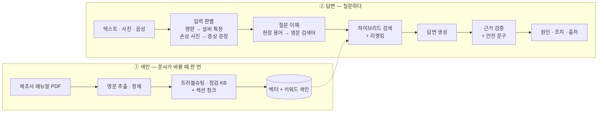

  

<h1 align="center">WANNA KNOW</h1>

  <b>컨베이어가 멈췄을 때, 매뉴얼을 뒤지지 말고 물어보세요.</b> 
  제조사 매뉴얼을 근거로 원인 · 조치 순서 · 안전 문구를 알려 주는 현장 컨베이어 문제 해결 챗봇

  
  
  
  
  
  

> **그런데 말입니다…**
> 모터가 뜨거워질 때 확인할 원인, 매뉴얼 몇 쪽에 적혀 있었을까요?

 

## 📋 프로젝트 소개

현장에서 컨베이어에 문제가 생겼을 때 증상을 **글 · 사진 · 음성**으로 전달하면 제조사 매뉴얼을 근거로 **원인 후보 · 조치 순서 · 안전 문구 · 출처 페이지**를 알려 주는 챗봇입니다.
SBS 〈그것이 알고싶다〉에서 콘셉트를 빌려, 매뉴얼 속에 흩어진 단서를 찾아 답을 추적합니다.

| 항목 | 내용 |
| --- | --- |
| 과정 | 현대 AI 인사이트캠퍼스 · AI 서비스개발 과정 **5조** |
| 주제 | 물류센터 컨베이어 고장 대응 RAG 챗봇 (🏢 현대무벡스 연계) |
| 타겟 | 입사 1~2년 차 컨베이어 정비 · CS 엔지니어 |
| 입력 | 텍스트, 사진(벨트 손상 · 설비 명판), 음성 |
| 기간 | 2026.10.21 ~ 11.02 (8일) |

### 왜 필요한가

- 설비마다 매뉴얼이 다르고 대부분 **영문 · 수십 쪽** 분량이라 고장 대응 중에 찾기 어렵습니다.
- 매뉴얼 용어(tracking, take-up)와 현장 용어(사행, 장력 조정 장치)가 달라 키워드 검색이 잘 안 됩니다.
- 일반 LLM은 근거 없이 그럴듯한 답을 만듭니다. 기술 매뉴얼 기반 고장 진단 연구에서 LLM 자유 답변의 환각률은 77~94%였습니다 (PHM Society 2025).

### 이렇게 답합니다

| 입력 | 답변 |
| --- | --- |
| "모터가 너무 뜨거워요" | 원인 3개(과부하 / 모터 저전압 / 감속기 윤활유 부족)와 조치, 안전 문구(LOTO), 출처(Hytrol 138-ACC p.22) |
| "감속기 오일 언제 갈아요?" | 처음 약 500시간 운전 후, 이후 2,500시간 또는 6개월 중 먼저 오는 때 |
| 📷 명판 사진 → "박스가 한쪽으로 쏠려요" | 설비를 138-ACC로 특정하고, 그 설비 매뉴얼의 섹션 직각 교정 절차로 답변 |
| 📷 벨트 가장자리 파손 사진 | 손상 유형을 판별해 원인 6개와 조치 안내 (사진이 불분명하면 재촬영 요청) |
| "AGV 배터리 교체 주기" | 매뉴얼에 근거가 없으므로 **"확인되지 않음"** |

### 무엇이 다른가

| 기존 방식 | 한계 | WANNA KNOW |
| --- | --- | --- |
| PDF 직접 검색 | 영문 키워드를 알아야 하고, 매뉴얼을 하나씩 열어야 함 | 한국어 현장 말로 질문, 여러 매뉴얼을 한 번에 검색 |
| 일반 LLM 챗봇 | 근거 없는 답, 설비 모델을 구분하지 못함 | 매뉴얼 페이지 · 원문 인용, 문서에 없으면 "확인되지 않음" |
| 기본 RAG | 표가 잘려 원인이 빠지고, 모델명 검색에 약함 | 트러블슈팅 표를 지식 베이스(KB)로 구조화, 하이브리드 검색 |
| 텍스트 전용 챗봇 | 설비를 말로 설명해야 함 | 명판 사진으로 설비 특정, 손상 사진 · 음성 입력 |

 

## ✨ 주요 기능

| 우선 | 기능 |
| :-: | --- |
| P0 | 텍스트 증상 Q&A, 출처(문서 · 페이지 · 원문) 인용, 안전 문구, 한·영 용어 변환, 자동 평가 |
| P1 | 모름 처리 · 되묻기, 점검 · 절차 질문, 하이브리드 검색, 로그 · 피드백 |
| P2 | 명판 사진으로 설비 특정, 벨트 손상 사진 분석, 대화 맥락 유지 |
| P3 | 음성 입력, 매뉴얼 그림 표시 |
| 확장 | 이상 소음 분류, 센서값 이상 감지, 정비 일정 에이전트 |

 

## 🔍 동작 방식

- **KB 구조화**: 매뉴얼의 트러블슈팅 표 1행을 KB 1건으로 만들고 원인마다 id를 붙입니다. LLM이 원인을 지어내지 않고, 채점도 id 비교로 자동화합니다.
- **근거 검증**: 답변의 원인이 검색된 문서에 실제로 있는지, 인용문이 원문과 일치하는지 코드로 확인합니다.
- **안전 문구**: LLM이 쓰지 않고, 매뉴얼의 안전 수칙 문장을 규칙으로 붙입니다.
- **모름 처리**: 검색 점수가 기준값보다 낮으면 "확인되지 않음"으로 답합니다.

### 화면 구성

- **채팅**: 텍스트 입력과 사진 첨부, 예시 질문 버튼, 답변마다 "도움됨 / 안 됨" 피드백
- **답변 순서**: 요약 1줄 → 안전 문구 → 원인 · 조치 → 다른 매뉴얼 참고 → 출처
- **설비 표시**: 명판으로 인식한 설비를 상단에 표시하고, "해제" 버튼으로 초기화
- **처리 과정 패널**: 출처 원문, 관련 그림, 백엔드 단계(입력 판별 → 질문 이해 → 검색 → 근거 검증)를 함께 표시

 

## 📚 데이터

현대무벡스 자료 대신 **공개된 제조사 매뉴얼**로 구성했습니다. 문서 폴더만 바꾸면 무벡스 매뉴얼로 교체할 수 있는 구조로 만들고, 발표에서 이를 시연합니다.

| 구분 | 자료 |
| --- | --- |
| 매뉴얼 | Hytrol 컨베이어 매뉴얼 8종 (약 85종 중 고장 유형이 겹치지 않는 것), Fenner Dunlop 벨트 매뉴얼 |
| 사진 | [Roboflow Conveyor Belt Damage](https://universe.roboflow.com/test-yfiry/conveyor-belt-damage-ucjlj) (CC BY 4.0), 팀이 만든 합성 명판 이미지 |
| 음성 | 팀원이 녹음한 테스트 음성 |

 

## 📊 평가

평가셋 **90문항**(텍스트 증상, 점검 · 절차, 명판 · 손상 사진, 음성, 범위 밖 질문, 다국어)을 명령 하나로 자동 채점합니다. 기본 RAG에서 시작해 단계마다 개선 효과를 수치로 비교합니다.

| 버전 | 추가한 것 |
| --- | --- |
| v0 | 기본 RAG (고정 길이 청킹 + 벡터 검색) |
| v1 | + KB 구조화, 섹션 청킹, 한·영 용어집 |
| v2 | + 하이브리드 검색, 리랭커, 설비 필터 |
| v3 | + 근거 검증, 모름 처리 기준값 |

| 목표 지표 | 목표 |
| --- | --- |
| 첫 번째 근거가 정답인 비율 | 0.75 이상 |
| 정답 원인을 답변에 포함한 비율 | 0.80 이상 |
| 출처(문서 · 페이지)가 정확한 비율 | 0.90 이상 |
| 범위 밖 질문에 "확인되지 않음"으로 답한 비율 | 0.80 이상 |
| 정비 · 조정 답변의 안전 문구 포함 | 100% |
| 텍스트 응답 시간 (p95) | 10초 이하 |

(버전별 결과는 측정 후 업데이트 예정)

 

## 🛠 기술 스택

| 구분 | 기술 |
| --- | --- |
| 언어 · 프레임워크 | Python, LangChain |
| LLM · 임베딩 | OpenAI API (텍스트 · 멀티모달 · 음성 인식 모델, text-embedding-3-small) |
| 검색 | Chroma (벡터 DB), rank_bm25 (키워드 검색), bge-reranker-v2-m3 (리랭커) |
| 문서 처리 | pdfplumber, PyMuPDF |
| 출력 검증 | pydantic |
| 웹 UI | Gradio |

 

## 📅 일정

📮 문서 제출 · 🔒 코드 마감

| 날짜 | 주요 작업 | 제출 · 마일스톤 |
| --- | --- | --- |
| 10/19 ~ 10/20 | 방향 확정 회의, 레포 · 개발 환경 세팅, 매뉴얼 수집 | |
| 10/21 (수) · Day 1 | 기획 확정, 매뉴얼 영문 추출, 기본 RAG(v0) | 📮 기능 명세서 |
| 10/22 (목) · Day 2 | 평가셋 · 채점 스크립트 완성, v0 점수로 평가 지표 회의 | 📮 WBS / Gantt |
| 10/23 (금) | 핵심 KB 구축, 웹 UI 골격 | |
| 10/26 (월) · Day 3 | 하이브리드 검색 · 리랭커, 답변 생성 · 근거 검증 | v1 측정 |
| 10/27 (화) · Day 4 | 설비 필터 · 모름 처리, 사진 · 명판 연결, 앱 통합 | 📮 UI/UX 설명서 · DB 스키마 |
| 10/28 (수) · Day 5 | 통합 테스트 · 버그 수정 | 🔒 17:50 코드 마감 |
| 10/29 (목) · Day 6 | E2E 테스트, 응답 시간 측정, 최종 평가 | 결과 리포트 |
| 10/30 (금) · Day 7 | 실행 재현 테스트, 시연 영상, 발표 자료 | |
| 11/02 (월) · Day 8 | 최종 발표, 기업 피드백 | 📮 최종 기획안 · 발표 자료, 소스 코드, 폴더 구조 캡처, 시연 영상 |

 

## 👥 팀원

<table>
  <tr>
    <td align="center"><a href="https://github.com/seram2002-wq"> <b>박세람</b></a> 팀장</td>
    <td align="center"><a href="https://github.com/Rose-Rosie-Rose"> <b>강경원</b></a> Repo Owner</td>
    <td align="center"><a href="https://github.com/wintery7"> <b>김민재</b></a> 팀원</td>
    <td align="center"><a href="https://github.com/clipnpaper"> <b>김현준</b></a> 팀원</td>
    <td align="center"><a href="https://github.com/daui1727"> <b>이정빈</b></a> 팀원</td>
    <td align="center"><a href="https://github.com/Y1OO5B"> <b>조윤빈</b></a> 팀원</td>
  </tr>
</table>

| 역할 | 주요 업무 |
| --- | --- |
| PM · 통합 | 일정 · 이슈 관리, 기능 통합, 웹 UI, 발표 자료 |
| 데이터 · KB | 매뉴얼 전처리, 트러블슈팅 · 점검 KB, 한·영 용어집 |
| 검색 | 청킹 · 색인, 하이브리드 검색 · 리랭킹, 설비 필터 |
| 생성 · 검증 | 답변 생성, 근거 검증, 안전 문구 규칙, 대화 상태 |
| 멀티모달 | 명판 판독, 손상 사진 분석, 음성 입력 |
| 평가 | 평가셋 · 자동 채점, 버전별 성능 비교 |

> 역할별 담당자는 확정 후 업데이트합니다.

 

## 🤝 협업 규칙

### 브랜치

| 브랜치 | 용도 | 예시 |
| --- | --- | --- |
| `main` | 배포 · 최종 결과물 | |
| `dev` | 기능 통합 · 테스트 | |
| `feat/*` | 새로운 기능 개발 | `feat/vector-search` |
| `fix/*` | 버그 · 오류 수정 | `fix/search-result-error` |
| `refactor/*` | 기능은 유지하고 코드 구조 개선 | `refactor/rag-chain` |

- 이름은 `작업유형/기능명` 형식으로 영문 소문자와 하이픈(-)을 씁니다. 여러 이슈가 동시에 진행되면 `feat/12-pdf-upload`처럼 이슈 번호를 붙일 수 있습니다.
- 브랜치를 만들기 전에 최신 `dev`를 반영하고, 브랜치 하나에서는 기능 하나만 개발합니다.

### 작업 흐름

**Issue 생성 → `dev`에서 브랜치 생성 → 개발 → `dev`로 PR → 리뷰 (2명 이상 승인) → Squash and Merge → 브랜치 삭제 → 통합 테스트 후 `dev` → `main`**

- `main`, `dev`에는 직접 push하지 않고 PR로만 병합합니다. 본인 PR은 본인이 승인할 수 없습니다.
- PR 본문에는 관련 Issue(`Closes #이슈번호`), 작업 개요, 주요 변경 사항, 테스트 내용, 참고 사항을 적습니다.
- `dev`로 병합한 PR은 이슈가 자동으로 닫히지 않을 수 있으니, 완료를 확인하고 직접 닫습니다.
- API Key, `.env` 등 민감한 정보는 커밋하지 않습니다.

### 커밋 · 이슈 · PR 제목

| 구분 | 형식 | 예시 |
| --- | --- | --- |
| 커밋 | `type: 작업 내용` | `feat: PDF 업로드 기능 추가` |
| 이슈 · PR 제목 | `[Type] 작업 내용` | `[Feat] PDF 업로드 기능 구현` |

커밋 type: `feat` 기능 추가, `fix` 버그 수정, `docs` 문서 수정, `style` 코드 형식 수정, `refactor` 구조 개선, `test` 테스트, `chore` 빌드·패키지·설정, `design` UI 디자인, `comment` 주석, `rename` 파일·폴더 이름·위치 변경, `remove` 파일·폴더 삭제, `hotfix` 긴급 버그 수정

 

## 🎨 팀 로고

SBS 〈그것이 알고싶다〉 타이틀에서 모티브를 얻었습니다.
노란 역삼각형 위에서 턱을 괸 캐릭터가 사양서 속 답을 궁금해하는 모습으로, **"기술사양서가 알고싶다"** 를 외칩니다.

 

---

  🎓 HYUNDAI AI Insight Campus · AI 서비스개발 과정 5조 
  본 프로젝트는 교육 목적의 팀 프로젝트이며, SBS 및 〈그것이 알고싶다〉와 무관합니다. 
  매뉴얼 원본의 저작권은 각 제조사에 있습니다.

